<picture>
  <source media="(prefers-color-scheme: dark)" srcset="./assets/source-dark.svg" />
  
</picture>

I test digital banking and payment applications. Over **4+ years** I've validated UPI payments, fund transfers, account management and loan servicing workflows through functional, API and performance testing, working in Agile teams. I automate regression scenarios with Selenium WebDriver, Python and PyTest, validate REST APIs and backend data with Postman and SQL, and run load tests with JMeter.

```ts
const sakshi: Engineer = {
  name: "Sakshi Rakesh Kumar",
  role: "Quality Assurance Professional",
  company: "Cognizant",
  location: "Montreal, Canada",
  yearsShipping: 6,
  languages: ["Python", "SQL", "PHP", "JavaScript", "Jinja", "HTML"],
  stack: ["PyTest", "Page Object Model", "Selenium WebDriver", "Postman", "Apache JMeter", "Jira", "Azure DevOps", "Azure DevOps Test Plans"],
  focus: "Risk-based testing and automation for online banking applications",
  career: [
    { at: "Cognizant", role: "Quality Assurance Engineer", when: "Jun 2025 – Present" },
    { at: "Paytm", role: "Quality Assurance Analyst", when: "Jul 2021 – Jul 2023" },
    { at: "CloudSphere IT Labs", role: "Software Test Engineer", when: "Jul 2020 – Jun 2021" },
  ],
  education: "Masters in Quality Systems, Concordia University",
};
```

## `projects.map(explain)`

<details>
<summary><code>projects.injectbench()</code> Prompt-injection evaluation harness with attack taxonomy and guardrail effectiveness measurement</summary>

</details>

<details>
<summary><code>projects.p2pExceptions()</code> Procure-to-pay invoice exception analysis with MECE cause taxonomy</summary>

</details>

<details>
<summary><code>projects.fieldExtract()</code> Document field extraction with calibrated confidence and cost-optimal review threshold</summary>

</details>

<details>
<summary><code>projects.sigmaForge()</code> Sigma detection-rule compiler rendering multiple query languages</summary>

</details>

<details>
<summary><code>projects.lineageLens()</code> Column-level data lineage resolver for impact analysis</summary>

</details>

<details>
<summary><code>projects.controlMap()</code> SOC 2 evidence automation with hashed evidence package</summary>

</details>

## `CHANGELOG.md`

### v3.0 · Cognizant

*June 2025 – Present*

- Designed risk-based test scenarios for online banking covering account management, fund transfers and loan servicing, translating business requirements into test cases
- Automated prioritized regression scenarios using Selenium WebDriver with Python, PyTest and the Page Object Model in Azure DevOps pipelines, achieving approximately **35% automation coverage**
- Validated REST APIs using Postman and SQL queries, checking account data, transaction postings and backend responses and investigating data-mapping discrepancies between integrated application components; performance-tested account and fund transfer REST APIs using Apache JMeter
- Executed end-to-end testing across web applications and backend services
- Evaluated AI-assisted test case generation against business requirements and edge cases

### v2.0 · Paytm

*July 2021 – July 2023*

- Executed functional, integration and regression tests for digital payment journeys involving UPI transactions, wallet operations and payment status updates
- Automated repeatable web application test cases using Selenium WebDriver with Python and PyTest, increasing automation coverage of selected payment regression scenarios by approximately **30%**
- Verified REST API responses using Postman and SQL queries, comparing transaction records with expected results
- Managed defects in Jira with reproduction steps, expected and actual results, severity and supporting evidence

### v1.0 · CloudSphere IT Labs

*July 2020 – June 2021*

- Prepared test cases from functional specifications for web-based applications, covering primary workflows, field validations, navigation and error messages
- Performed manual functional and regression testing after application changes, executing approximately **100 test cases per release cycle** across assigned modules
- Documented defects in Jira with reproduction steps, screenshots and expected results; supported API and database validation using Postman and basic SQL queries

## `npm ls --depth=0`

<p align="center">
  
</p>

## `contact()`

[`linkedin`](https://www.linkedin.com/in/sakshirkumar/) · [`github`](https://github.com/sakshirkumar)

## Projects

- [injectbench](https://github.com/sakshirkumar/injectbench) — Prompt-injection evaluation harness that reports attack success rate by attack taxonomy with confidence intervals and measures which guardrail actually reduces…
- [p2pexceptions](https://github.com/sakshirkumar/p2pexceptions) — Procure-to-pay invoice exception analysis that classifies each failed three-way match into a MECE cause taxonomy validated against hand labels, with a…
- [fieldextract](https://github.com/sakshirkumar/fieldextract) — Document field extraction with per-field calibrated confidence and a cost-optimal review threshold, so operations knows which fields need a human; runs on a…
- [sigmaforge](https://github.com/sakshirkumar/sigmaforge) — A Sigma detection-rule compiler that parses rules into a typed expression tree and renders Splunk SPL, Elastic EQL, Microsoft KQL and SQLite SQL, checked by…
- [lineagelens](https://github.com/sakshirkumar/lineagelens) — Column-level data lineage that resolves SELECT *, CTEs and subqueries to show exactly which dashboards break when a source column changes.
- [costtoserve](https://github.com/sakshirkumar/costtoserve) — An activity-based cost-to-serve model that flags customers whose profitability sign flips depending on which allocation driver is used.
- [cuped](https://github.com/sakshirkumar/cuped) — A CUPED variance-reduction library that refuses covariates measured after randomisation and tests that bias case explicitly.
- [privkit](https://github.com/sakshirkumar/privkit) — A privacy toolkit for data pipelines covering PII detection, NIST FF1/FF3-1 format-preserving tokenization, k-anonymity and l-diversity, and differential…
- [reachable](https://github.com/sakshirkumar/reachable) — A CVE triage tool that checks static call-graph reachability from entry points to the vulnerable function, returning reachable, not-reachable or indeterminate…
- [controlmap](https://github.com/sakshirkumar/controlmap) — SOC 2 evidence automation that collects exports from GitHub, AWS, identity and HR systems, evaluates YAML controls, maps them to criteria and builds a hashed…
